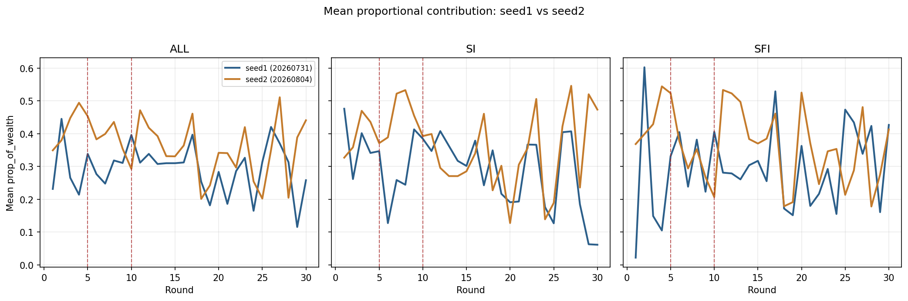
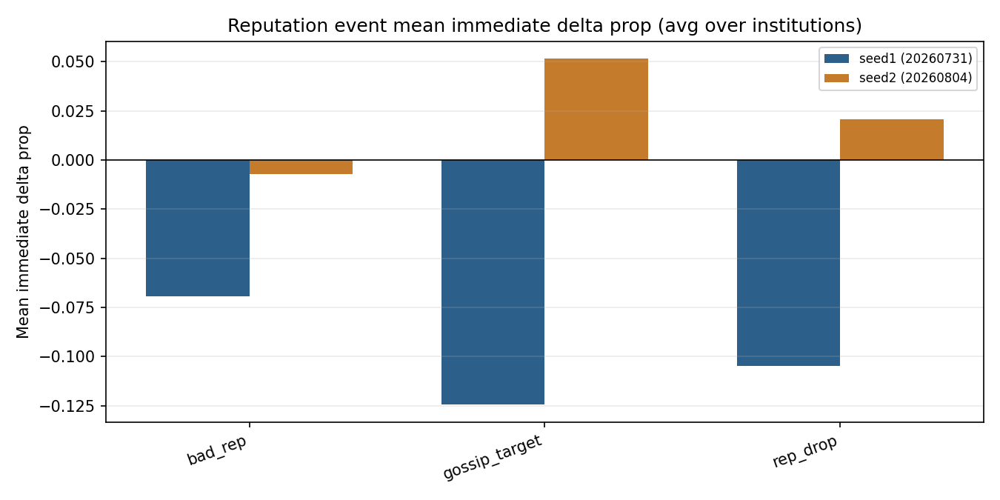
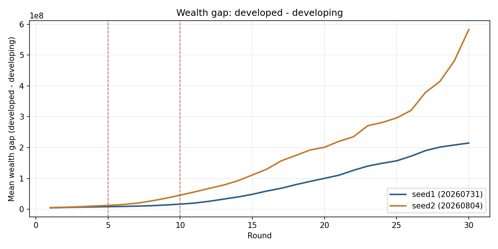
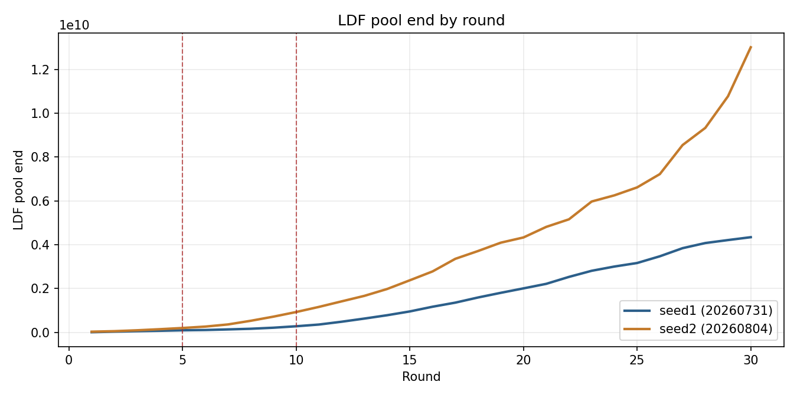
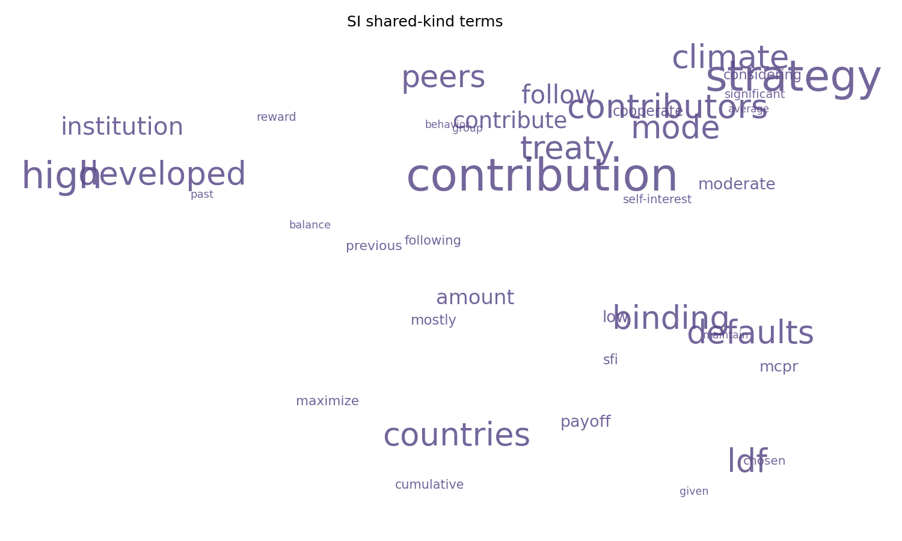

# ELICIT: Emergent LLM Institutions for Climate and International Treaties

[](https://www.python.org/downloads/)
[](LICENSE)
[]()

**ELICIT** (**E**mergent **L**LM **I**nstitutions for **C**limate and **I**nternational **T**reaties) is a research framework and agent-based economic simulation designed to examine cooperation, sanctioning, governance, and climate risk-sharing among heterogeneous Large Language Model (LLM) agents under repeated public goods games and environmental shocks.

---

## Executive Summary & Key Visual Insights

**Read this first: ELICIT is now framed as an audit of LLM-agent social simulation, not as a claim about cooperation.**

The single-condition, nine-seed result pack this repository was built around cannot support a causal claim, and it does not pretend to. What it *can* support — and what the code now measures directly — is a set of validity checks on the instrument itself.

Concretely, three findings from the pre-revamp analysis are stated here without overclaiming, because each is a measurement rather than an interpretation:

- **Cooperation is high but not attributable.** Contribution intensity averages ~0.93 of the pre-decision cap across nine runs of one condition, yet at the design's own payoffs the marginal return to contributing (MCPR = β/n ≈ 0.13) is far below 1, so contributing zero is a strict best response in every round. The observed cooperation is therefore a property of the prompt and the model prior, not a payoff-equilibrium outcome. `analysis/best_response.py` turns this into a per-decision deviation rate.
- **The gossip/intensity association is unstable.** Its interval crosses zero and its *sign flips across thresholds 3–7*. Our own claim-strength matrix grades it exploratory and non-causal and explicitly forbids using "backfires" as a headline. An earlier version of this README said exactly that and contradicted the analysis; it has been corrected.
- **Heterogeneity across seeds is an order of magnitude.** The terminal developed/developing wealth ratio spans 0.674–8.176 across nine runs of the *same* configuration. A reliability problem about the instrument is a finding in its own right.

The robustness grid in `configs/` exists to test that fragility directly: three model families × three prompt variants × four seeds, with parameter parity enforced in code, an explicit seed vector per run, and the pre-committed reporting rules written before the first cell executes.

**What was fixed, and why it matters.** The pre-revamp code had defects that a referee would find, and fixing them raised credibility more than any amount of extra prose would have:

| Defect | Consequence | Now |
|---|---|---|
| Oracle cooperation rate divided by an import-time constant | Every one of the 54 historical constitutional sessions was annotated with a statistic of order 10⁵ instead of 10⁻¹ | Wealth-scaled and clipped to `[0, 1]`; `tests/test_verification_gate.py` asserts the bound |
| `MAX_PUNISHMENT_TOKENS` never enforced, its only enforcer dead code | A decorative flag a reviewer can trace | Deleted; grep returns zero hits |
| `CONTRIBUTION_CAPACITY` and `HISTORICAL_EMISSIONS` logged and prompted but in no payoff | Two parameters that look causal and are not | Capacity now scales the Stage-1 cap; emissions are the `cbdr` payout weight |
| Shocks at rounds 5 and 10, constitutional sessions every 5 rounds | Every "shock response" was also a "rule-change response" | Shocks moved to rounds 7 and 17; asserted by a test |
| `SEED` seeded `random` only and never appeared in run filenames | Nine "replications" that may be one draw | Explicit, serialised seed vector covering Python, per-agent, per-persona and sampler seeds |
| LDF allocation rule was a hardcoded constant | The institution's distributional core was exogenous | A registry of six named rules, electable by the assembly under four governance levels |
| No best-response or equilibrium code anywhere | No yardstick for "cooperation" | `analysis/best_response.py` |

### 1. Institutional Cooperation Trajectories

Agents interact under two distinct institutional structures: **Sanctioning Institutions (SI)**, which permit peer punishments and rewards, and **Sanction-Free Institutions (SFI)**, which lack stage-2 peer enforcement. While overall contribution intensity remains moderately positive, cooperation levels vary across seeds while SI and SFI means track closely within each run.


*Figure 1: Round-mean contribution intensity relative to wealth by institution across independent replications (Run A vs. Run B).*

### 2. Social Pressure & Response Dynamics

When non-enforcing (SFI) agents receive bad reputation scores or are targeted in peer gossip bulletins, their subsequent contribution intensity drops on average ($\Delta\mathrm{prop} < 0$). Without formal sanctioning powers, agents respond to public shaming by withdrawing cooperation rather than repairing their standing. In enforcing institutions (SI), responses reverse sign across replications.


*Figure 2: Immediate change in contribution intensity ($\Delta\mathrm{prop}$) following social marks (gossip, bad reputation, reputation drops) across institutions and replications.*

### 3. Global Inequality & Loss & Damage Fund (LDF) Dynamics

Under climate shocks, developed (Global North) agents are assigned to enforcing institutions (SI) while developing (Global South) agents reside in SFI. A persistent Loss & Damage Fund (LDF) collects contributions and pays out climate damages. Despite achieving ~75% damage coverage, **wealth gaps between developed and developing agents continuously widen**, while LDF pool stocks grow far beyond cumulative damage payouts.

<p align="center">
  
  
</p>

*Figure 3: (Left) Developed-minus-developing mean wealth gap widening over time. (Right) Loss & Damage Fund terminal stock balances accumulating beyond cumulative payouts.*

### 4. Emergent LLM Rationales & Rhetoric

Qualitative analysis of LLM agent prompt rationales reveals that post-event adjustments rarely cite reputation repair or moral obligation. Instead, agents frame decisions around opportunistic payoffs, immediate risk, and marginal return calculations.


*Figure 4: Wordcloud of emergent rationale unigrams for Sanctioning Institution (SI) agents, highlighting strategic, incentive-driven language.*

---

## Core Research Architecture

ELICIT models a complex multi-agent climate micro-economy featuring multi-stage interactions, cognitive modules, and institutional evolution.

```
       ┌─────────────────────────────────────────────────────────┐
       │             Round Initialization & Routing              │
       │    (Developed -> SI Institution, Developing -> SFI)     │
       └────────────────────────────┬────────────────────────────┘
                                    │
       ┌────────────────────────────▼────────────────────────────┐
       │     Stage 1: Public Goods Contribution (LLM Decision)   │
       └────────────────────────────┬────────────────────────────┘
                                    │
       ┌────────────────────────────▼────────────────────────────┐
       │      Public Goods Return Distribution & Payoffs         │
       └────────────────────────────┬────────────────────────────┘
                                    │
       ┌────────────────────────────▼────────────────────────────┐
       │  Stage 2: Peer Punishments & Rewards (SI Members Only)  │
       └────────────────────────────┬────────────────────────────┘
                                    │
       ┌────────────────────────────▼────────────────────────────┐
       │ Climate Shocks, LDF Payouts & Subsidy Redistribution   │
       └────────────────────────────┬────────────────────────────┘
                                    │
       ┌────────────────────────────▼────────────────────────────┐
       │ Social Monitoring: ToM Audits, Reputation & Gossip      │
       └────────────────────────────┬────────────────────────────┘
                                    │
       ┌────────────────────────────▼────────────────────────────┐
       │  Constitutional Democracy Session (Periodic Voting)      │
       └─────────────────────────────────────────────────────────┘
```

### Key Framework Components

1. **Heterogeneous Agent Economics**:
   - Initial endowment asymmetry (Developed vs. Developing economic profiles).
   - Wealth tracking, marginal returns on public goods, and private investment options.
2. **Institutional Asymmetry**:
   - **Sanctioning Institution (SI)**: Enables Stage-2 costly peer punishment and reward allocations.
   - **Sanction-Free Institution (SFI)**: Public goods contributions only, without peer sanction mechanisms.
3. **Cognitive & Social Information Modules**:
   - **Theory of Mind (ToM) Audits**: Batched audits evaluating peer consistency and expected strategies.
   - **Peer Gossip System**: Broadcasts public bulletins highlighting agents with low consistency scores or aberrant contribution behaviors.
   - **Reputation Scoring**: Dynamic numerical reputation ratings displayed in agent prompt context.
4. **Climate Shocks & Loss & Damage Fund (LDF)**:
   - Stochastic climate disaster events impacting agent wealth.
   - Dual-purpose Loss & Damage Fund collecting contributions to insure developing agents against shock damage.
5. **Constitutional Democracy**:
   - Periodic voting sessions where agents propose, debate, and vote on institutional rule changes (e.g., subsidy adjustments, voting thresholds, punishment scaling).

---

## Summary of Main Empirical Findings

Stated at the strength the evidence supports, with the evidence tier named. A referee or admissions reader who finds an overstated claim here will discount everything else in this repository.

1. **Cooperation is high but is not payoff-optimal** *(measurement, not attribution)*.
   Contribution intensity averages ≈ 0.93 of the pre-decision cap. At the design's own payoffs, MCPR = β/n ≈ 0.13, so contributing zero is a strict best response in every round and there is no continuation value. `analysis/best_response.py` reports the deviation rate from that best response, overall and by prompt variant.
2. **Gossip targeting is associated with lower contribution, but the association is unstable** *(exploratory, non-causal)*.
   The interval crosses zero and the sign flips across thresholds 3–7. This is **not** a claim that gossip backfires; a threshold was not selected, and the claim-strength matrix forbids that framing.
3. **Institutional heterogeneity is enormous and under-explained** *(descriptive, robust)*.
   The terminal developed/developing wealth ratio spans **0.674–8.176** across nine runs of one identical configuration. Reported transfers are 0.168–0.504% of deposits and payouts are exactly 0.900 × damage for eligible claimants whenever the pool suffices, so the 0.900 figure is a mechanical cap rather than a behavioural estimate.
4. **Participation rose without substantive redistribution** *(descriptive, robust)*.
   The wealth gap narrowed in every run, but the LDF is a tiny fraction of the flow; the gap is driven by the designed endowment profile, the vulnerability asymmetry and group size. Framing it as "the LDF fails" would be a category error — the LDF is doing what its arithmetic says.
5. **The sanction map is substantially the safety net's, not the model's** *(measurement)*.
   29.7% of SI agent-rounds carry `auto_fitted_to_budget` and the requested-to-final punishment token discard ratio is ≈ 0.387. Raw requested allocations are now logged alongside applied ones so the intervention is a measured quantity.
6. **Long-horizon reasoning is an interpretation, not an observation** *(limitation)*.
   Rationales average 8.45 words and only 41.2% are unique; 1 of 7,020 matched a fairness/equity codebook. Sampled deliberation traces (`TRACE_ENABLED`) now preserve prompt and raw completion so this section rests on transcripts rather than on summaries.

### What the robustness grid will decide

Pre-committed in `configs/grid_full.yaml`; report whichever occurs.

| Question | Pre-registered reading |
|---|---|
| Does `σ²_prompt + σ²_model` exceed `σ²_seed`? | If yes, the outcome is a property of the instrument — a publishable, general finding about the genre |
| Is there a discontinuity in participation at MCPR = 1? | If yes, agents respond to the payoff structure and the instrument has construct validity; if no, cooperation is a prompt/alignment artefact |
| Does the deviation rate differ between P0 and P2? | Quantifies prompt steering with a game-theoretic yardstick rather than a lexical one |
| Does one allocation rule win across model families? | A shared normative preference; if the winner differs by family, that is the reliability paper's second headline |

---

## Repository Structure

```text
.
├── docs/                       # Research documentation & TeX sources
│   └── paper/                  # Complete LaTeX paper source & compiled PDF
│       ├── figures/            # High-resolution experiment plots & figures
│       ├── tables/             # LaTeX metrics & summary tables
│       ├── sections/           # Paper LaTeX chapters (Abstract, Results, etc.)
│       └── main.pdf            # Compiled research paper
├── src/                        # Core Python simulation engine
│   ├── main.py                 # Single-run execution entry point
│   ├── run_experiments.py      # Batch experiment sweeps across seeds/conditions
│   ├── core/                   # Engine logic (agent, environment, institution, LDF, params)
│   ├── modules/                # Cognitive/governance (ToM, Gossip, Democracy, Oracle)
│   ├── prompts/                # Prompt builders & template generation
│   ├── parsing/                # Robust JSON response parsers
│   ├── llm/                    # Ollama client wrapper (OpenAI API / reasoning)
│   └── analysis/               # Plot generation & ablation metrics exporters
├── results/                    # Raw simulation JSON outputs
├── analysis_outputs/           # Post-processed plots and CSV metrics (gitignored)
└── dashboard/                  # Interactive HTML/JS browser visualizer for results
```

---

## Getting Started & Reproducibility

### 1. Installation

Clone the repository and install the dependencies:

```bash
git clone https://github.com/uzairlol/ELICIT-fyp.git
cd ELICIT-fyp
pip install -r requirements.txt
```

### 2. LLM Setup (vLLM)

ELICIT runs against a local LLM served by [vLLM](https://docs.vllm.ai/) via its OpenAI-compatible API (a legacy Ollama backend is still available via `LLM_BACKEND = "ollama"` in `src/core/parameters.py`).

Serve the 9GB 4-bit Qwen 2.5 14B on Kaggle T4 x2 (KV-cache sized so VRAM never spills to RAM):

```bash
bash scripts/serve_vllm.gptq_tp2.sh   # both T4s (recommended, ~5x vs Ollama)
# or, for your existing 9GB GGUF model:
bash scripts/serve_vllm.gguf.sh       # single T4 (drop-in for qwen2.5:14b Q4_K_M)
```

Windows workstation: `powershell -File scripts/serve_vllm.windows.ps1`.

Tuning knobs live in `src/core/parameters.py`:
- `LLM_MAX_CONCURRENCY` / `TOM_MAX_CONCURRENCY` — Python-side fan-out for the contribution/belief and the pairwise ToM audits (ToM is ~90% of all LLM calls).
- Keep both at or below the server's `--max-num-seqs` so requests batch on the GPU instead of queuing. KV spill to CPU RAM is off by default in current vLLM, so the KV cache stays in VRAM.

```bash
# Pull the model used by the serve scripts (GGUF variant, single-file Q4_K_M)
huggingface-cli download bartowski/Qwen2.5-14B-Instruct-GGUF \
    Qwen2.5-14B-Instruct-Q4_K_M.gguf --local-dir ~/models
```

### 3. Running a Single Simulation

Run a default simulation run with the served Qwen model:

```bash
python src/main.py
```

Common Command Line Arguments:

```bash
# Custom LLM model (must match the vLLM --served-model-name)
python src/main.py --model-name qwen2.5-14b

# Enable Climate Shocks & Loss and Damage Fund (LDF)
python src/main.py --scenario ldf --enable-climate-shocks --enable-ldf

# Change agent counts or round horizon
python src/main.py --num-agents 26 --num-rounds 30

# Baseline comparison with heuristic/random agents
python src/main.py --agent-type Random
```

Results are saved as timestamped JSON files under `results/`. Debug logs detailing prompt/response pairs are placed in `src/debug_logs/`.

### 4. Running Experiment Sweeps & Ablations

To reproduce multi-seed paper experiments and ablation sweeps:

```bash
python src/run_experiments.py --scenario ldf --enable-climate-shocks --enable-ldf
```

Flags for controlled execution:

```bash
# Fast validation run across a single seed
python src/run_experiments.py --quick-compare --seeds 1

# Execute full agent population sweeps only
python src/run_experiments.py --full-only
```

### 5. Figure Generation & Dashboard Visualization

#### Generating Plots & Metrics

To export publication metrics and regenerating paper plots from `results/`:

```bash
# Interactive per-run diagnostic plots
python src/analysis/plot_results.py

# Export aggregated metrics CSVs and PNG figures
python src/analysis/export_ablation_metrics.py
python src/analysis/export_ablation_plots.py

# Rationale unigram wordclouds
python src/analysis/plot_wordcloud.py
```

#### Web Visualizer Dashboard

Launch an interactive visualizer in your browser to inspect agent decision chains, round payoffs, gossip events, and voting results:

1. Open `dashboard/index.html` in any modern Web Browser.
2. Load any JSON file from the `results/` folder to explore round-by-round trajectory timelines.

---

## Citation & Research Paper

The manuscript is **not yet a citable claim**. A preprint DOI will replace this section on submission; until then, cite the repository and the pre-registered protocol, not a paper.

```bibtex
@misc{elicit2026,
  title  = {{ELICIT}: An Audit of LLM-Agent Social Simulation in a Climate Burden-Sharing Institution},
  author = {{ELICIT Research Team}},
  year   = {2026},
  note   = {Pre-registered robustness audit; protocol in docs/paper/ and configs/grid_full.yaml},
  url    = {https://github.com/uzairlol/ELICIT-fyp}
}
```

> `assets/paper_v2.tex` is **superseded and retained only as an archive**. It reports a single run, a different MCPR and a different LDF total from `docs/paper/qwen_2_5_14b_9seed_results_report.md`. Do not cite it, and do not read its numbers as current.

---

## Running the robustness grid

A run is defined by a versioned config, not by editing `parameters.py`. `elicit` is the entry point.

```bash
# What is registered?
elicit preset list
elicit params                      # every parameter, and whether anything reads it

# What will a grid cost, and does it hold parity across models?
elicit grid show --grid configs/grid_arm_a.yaml

# Preflight before every compute session
elicit doctor --model qwen2.5-14b

# Execute one cell locally
elicit run --preset a_qwen_p0 --seed-index 1

# Execute a manifest, resumably
elicit grid run --grid configs/grid_arm_a.yaml --resume

# Export Kaggle-ready bundles: config + runner + serve script per cell
elicit export --grid configs/grid_full.yaml --out kaggle_bundles --zip full
```

Then open `src/kaggle/fyp-grid-qwen2-5-14b.ipynb` on Kaggle, set `SERVED_MODEL`, and run all cells. One session loads one model, so run it once per alias per account.

After the runs land in `results/`:

```bash
python -m analysis.revamp_run_all --results-dir results --out analysis_outputs/revamp
```

That produces the four pre-committed headline artefacts: the variance decomposition, the MCPR response curve, the best-response deviation rate, and the governance tables.

---

## License

This project is licensed under the MIT License - see the [LICENSE](LICENSE) file for details.
